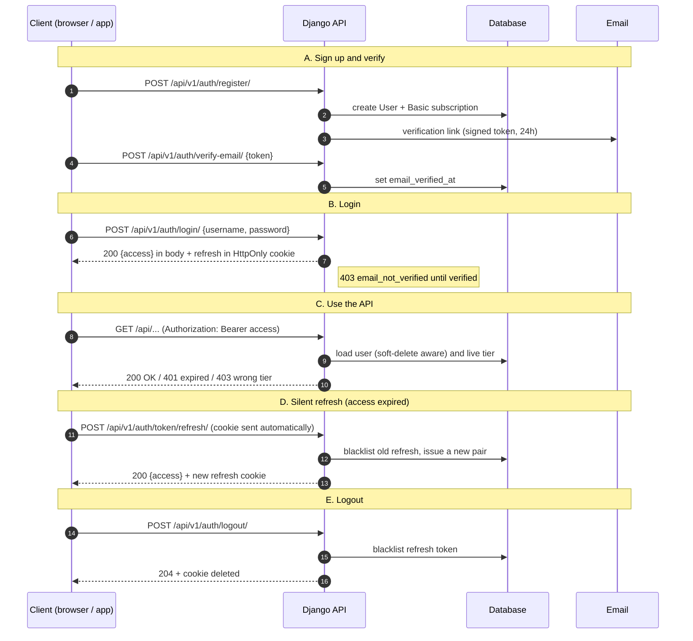

# JWT Auth + Subscription Tiers (Basic / Platinum / Diamond) for Django REST

Stack: Django 6.1 + DRF + `djangorestframework-simplejwt`, on the custom
`users.User` (UUID primary key, soft delete) and the `config.models` mixins.

> **This repository is the reference implementation.** The code snippets below
> are excerpts to explain the design; when they differ, the files in the repo
> win. The frontend contract lives in [`auth-api.md`](./auth-api.md).

## 0. The design in one paragraph

- **Authentication** (who are you?) = short-lived JWT access token (15 min) +
  rotating, blacklistable refresh token (7 days) stored in an `HttpOnly` cookie.
- **Authorization by plan** (what can you use?) = a `Plan` catalog
  (`basic` / `platinum` / `diamond`) and a `Subscription` table linking a user to
  a plan with a status and billing period. A user has **many** subscriptions over
  time (history) but only **one live** one (enforced by a partial unique
  constraint).
- The tier is **embedded in the access token as a claim for UI convenience**, but
  permission checks **read the database**, so an upgrade, downgrade or expiry
  takes effect on the next request instead of when the token expires.
- Every new user gets a **Basic** subscription at registration. Paid upgrades
  must be driven by **payment-provider webhooks**, never by a client calling
  "upgrade me". There is intentionally no client-facing upgrade endpoint.

Project layout:

```
config/
  settings.py      env-driven settings, JWT, cookies, throttles, security
  exceptions.py    consistent {detail, code[, errors]} error envelope
  urls.py          /api/v1/auth/ and /api/v1/subscriptions/
  models.py        time-stamped / audited / soft-delete mixins
users/
  models.py        User (UUID pk, soft delete, email_verified_at, tier properties)
  services.py      UserManager (soft-delete aware, lower-cases emails)
  serializers.py   register / login / refresh / me / password serializers
  views.py         register, verify, login, refresh, logout, me, passwords
  tokens.py        email verification + reset tokens, revoke-all-refresh
  cookies.py       refresh-cookie helpers
  exceptions.py    EmailNotVerified (403)
subscriptions/
  models.py        Tier, TIER_RANK, Plan, Subscription
  services.py      get_live_subscription, get_user_tier, change_plan, expiry
  permissions.py   tier_required() / IsPlatinumOrHigher / IsDiamond
  serializers.py   PlanSerializer, SubscriptionSerializer
  views.py         plans, my subscription, demo gated endpoints
  plan_defaults.py shared seed data for Basic / Platinum / Diamond
  management/commands/seed_plans.py, expire_subscriptions.py
```

### 0.1 Error envelope

`config.exceptions.api_exception_handler` gives every error a stable,
machine-readable `code`:

```json
{"detail": "Please verify your email before logging in.", "code": "email_not_verified"}
```

Validation errors also include per-field messages:

```json
{
  "detail": "Validation failed.",
  "code": "invalid",
  "errors": {"email": ["A user with this email already exists."]}
}
```

Clients branch on `code`, never on `detail` (it may change or be translated).
The full list is in `auth-api.md`.

### 0.2 The auth flow at a glance



Step by step:

1. **Register**: creates the user (unverified), gives them the free Basic plan in
   the same transaction, and emails a signed verification link (sent only after
   the transaction commits).
2. **Verify email**: the frontend page behind the link posts the token; the
   server checks the signature and age (24 h) and stamps `email_verified_at`.
   Changing the account email invalidates existing links.
3. **Login**: username + password are checked first. Unverified users get
   `403` with `code: "email_not_verified"` (not `401`, so clients do not start a
   refresh loop). On success the body contains a 15-minute **access token** and
   the 7-day **refresh token** is set in an `HttpOnly` cookie JavaScript cannot
   read.
4. **Call the API**: the client sends `Authorization: Bearer <access>`. The
   server validates signature/expiry, loads the user through the soft-delete
   manager (deleted/inactive users are rejected), and permission classes check
   the live tier in the database.
5. **Refresh**: when the access token expires (`401`), the client calls
   `/token/refresh/`. The browser attaches the cookie itself. The old refresh
   token is blacklisted and a new one is issued (rotation). Replaying an
   already-used refresh token fails.
6. **Logout**: the refresh token is blacklisted and the cookie is cleared. The
   short-lived access token simply expires on its own (always ≤ 15 min). This is
   the trade-off of stateless JWTs and the reason the access lifetime is short.
7. **Forgot password**: the response is always identical (no account
   enumeration), the link expires in 1 hour, is single-use (it dies when the
   password hash changes), and **every refresh token for that user is revoked**.
8. **Change password**: requires the old password, revokes every refresh token
   and clears the cookie. The current access token still lives for at most
   15 minutes; the client must discard it immediately.

Token cheat sheet:

| Token                | Lifetime         | Where it lives                                  | Sent how                       | Revocable                       |
| -------------------- | ---------------- | ----------------------------------------------- | ------------------------------ | ------------------------------- |
| Access JWT           | 15 min           | JS memory (never `localStorage`)                | `Authorization: Bearer`        | No; expires fast                |
| Refresh JWT          | 7 days, rotating | `HttpOnly; Secure` cookie, path `/api/v1/auth/` | Browser attaches automatically | Yes; blacklist table            |
| Email verify token   | 24 h             | Link in email                                   | Request body                   | Dies if the email changes       |
| Password reset token | 1 h, single use  | Link in email                                   | Request body                   | Dies once the password changes  |

---

## 1. Install

```bash
# with uv (the repo already has a lockfile)
uv sync

# or with pip
pip install djangorestframework djangorestframework-simplejwt
```

`python manage.py startapp subscriptions` is not needed: the app exists.

## 2. Settings (`config/settings.py`)

The important parts (the file is the source of truth):

```python
DEBUG = env("DEBUG")

# No insecure fallback when DEBUG=False: the process refuses to start.
SECRET_KEY = env("SECRET_KEY", default="django-insecure-dev-only-key" if DEBUG else None)
if not SECRET_KEY:
    raise ImproperlyConfigured("SECRET_KEY must be set when DEBUG=False")

# Dedicated JWT key; rotating it invalidates every outstanding token.
JWT_SIGNING_KEY = env("JWT_SIGNING_KEY", default=SECRET_KEY)

INSTALLED_APPS = [
    "django.contrib.admin",
    "django.contrib.auth",
    "django.contrib.contenttypes",
    "django.contrib.sessions",
    "django.contrib.messages",
    "django.contrib.staticfiles",
    "rest_framework",
    "rest_framework_simplejwt",
    "rest_framework_simplejwt.token_blacklist",  # logout / refresh revocation
    "users",
    "subscriptions",
]

AUTH_USER_MODEL = "users.User"  # MUST be set before the first migrate

REST_FRAMEWORK = {
    "DEFAULT_AUTHENTICATION_CLASSES": (
        "rest_framework_simplejwt.authentication.JWTAuthentication",
    ),
    "DEFAULT_PERMISSION_CLASSES": (
        "rest_framework.permissions.IsAuthenticated",  # secure by default
    ),
    "DEFAULT_THROTTLE_CLASSES": (
        "rest_framework.throttling.AnonRateThrottle",
        "rest_framework.throttling.UserRateThrottle",
        "rest_framework.throttling.ScopedRateThrottle",
    ),
    "DEFAULT_THROTTLE_RATES": {
        "anon": "100/hour",
        "user": "2000/hour",
        "login": "5/min",       # brute-force protection
        "register": "10/hour",
        "email": "5/hour",      # verification / password-reset emails
        "refresh": "60/hour",   # silent refresh + retry storms
    },
    "EXCEPTION_HANDLER": "config.exceptions.api_exception_handler",
}

SIMPLE_JWT = {
    "ACCESS_TOKEN_LIFETIME": timedelta(minutes=15),
    "REFRESH_TOKEN_LIFETIME": timedelta(days=7),
    "ROTATE_REFRESH_TOKENS": True,       # every refresh issues a new refresh token
    "BLACKLIST_AFTER_ROTATION": True,    # old refresh token becomes unusable
    "UPDATE_LAST_LOGIN": True,
    "ALGORITHM": "HS256",
    "SIGNING_KEY": JWT_SIGNING_KEY,
    "AUTH_HEADER_TYPES": ("Bearer",),
    "USER_ID_FIELD": "id",               # User UUID pk (simplejwt stringifies it)
    "USER_ID_CLAIM": "user_id",
    "TOKEN_TYPE_CLAIM": "token_type",
}

AUTH_COOKIE_REFRESH = "refresh_token"
AUTH_COOKIE_SECURE = not DEBUG           # True in production (HTTPS only)
AUTH_COOKIE_SAMESITE = "Lax"             # "None" only for a truly cross-site frontend
AUTH_COOKIE_PATH = "/api/v1/auth/"       # not sent to the rest of the API
AUTH_COOKIE_MAX_AGE = int(SIMPLE_JWT["REFRESH_TOKEN_LIFETIME"].total_seconds())

FRONTEND_URL = env("FRONTEND_URL", default="http://localhost:3000").rstrip("/")
EMAIL_VERIFY_MAX_AGE = 60 * 60 * 24      # 24 hours
PASSWORD_RESET_TIMEOUT = 60 * 60         # 1 hour (Django's reset-token setting)
```

Production security defaults (`SECURE_SSL_REDIRECT`, HSTS, secure session/CSRF
cookies, `X_FRAME_OPTIONS = "DENY"`) are applied automatically when
`DEBUG=False`; `TRUST_PROXY_HEADERS=True` enables
`SECURE_PROXY_SSL_HEADER` behind a TLS-terminating proxy.

Environment variables (start from `.env.example`):

| Variable                | Default                  | Notes                                      |
| ----------------------- | ------------------------ | ------------------------------------------ |
| `SECRET_KEY`            | dev-only when `DEBUG`    | **required** when `DEBUG=False`            |
| `JWT_SIGNING_KEY`       | `SECRET_KEY`             | dedicated key recommended                  |
| `DEBUG`                 | `False`                  |                                            |
| `ALLOWED_HOSTS`         | `[]`                     | comma-separated                            |
| `DATABASE_URL`          | local SQLite             | Postgres in production                     |
| `FRONTEND_URL`          | `http://localhost:3000`  | used to build email links                  |
| `AUTH_COOKIE_SECURE`    | `not DEBUG`              | must be `True` with `SameSite=None`        |
| `AUTH_COOKIE_SAMESITE`  | `Lax`                    | `None` requires HTTPS + CSRF defense      |
| `EMAIL_BACKEND`         | console                  | use SMTP/transactional provider in prod    |
| `DEFAULT_FROM_EMAIL`    | `webmaster@localhost`    |                                            |

Notes:

- simplejwt loads users through `User.objects`, the soft-delete-aware manager, so
  a soft-deleted user's tokens stop working on the next request.
- `is_active=False` users are rejected by authentication and by refresh.
- `JWT_SIGNING_KEY` rotation invalidates all tokens at once; that is an
  emergency lever, not a routine operation.

## 3. Models

`users.User` uses a UUID primary key and adds verification state:

```python
class User(TimeStampedMixin, SoftDeleteMixin, AbstractBaseUser, PermissionsMixin):
    id = models.UUIDField(primary_key=True, default=uuid.uuid4, editable=False)
    username = models.CharField(max_length=150, unique=True)
    email = models.EmailField(unique=True)
    email_verified_at = models.DateTimeField(null=True, blank=True)
    ...
    objects = UserManager()

    @property
    def is_email_verified(self) -> bool:
        return self.email_verified_at is not None

    @property
    def tier(self) -> str:
        from subscriptions.services import get_user_tier
        return get_user_tier(self)

    @property
    def subscription(self):
        from subscriptions.services import get_live_subscription
        return get_live_subscription(self)
```

`UserManager.create_superuser` sets `email_verified_at=timezone.now()` so admins
created with `createsuperuser` are not locked out. `UserManager` lower-cases
emails, so `Sam@Example.com` and `sam@example.com` cannot both exist.

`subscriptions/models.py` defines the catalog and history:

```python
class Tier(models.TextChoices):
    BASIC = "basic", _("Basic")
    PLATINUM = "platinum", _("Platinum")
    DIAMOND = "diamond", _("Diamond")

TIER_RANK = {Tier.BASIC: 1, Tier.PLATINUM: 2, Tier.DIAMOND: 3}

def tier_rank(tier: str) -> int:
    try:
        return TIER_RANK[Tier(tier)]
    except (KeyError, ValueError):
        return 0

LIVE_STATUSES = (
    SubscriptionStatus.TRIALING,
    SubscriptionStatus.ACTIVE,
    SubscriptionStatus.PAST_DUE,  # grace period while a payment retries
)
```

`Plan` is a data row (prices, JSON `limits`, provider price ids), so pricing and
feature limits change without a deploy. `Subscription` keeps history; changing
plans closes the old row and opens a new one. The key invariant is enforced by
the database, not just by application code:

```python
constraints = (
    models.UniqueConstraint(
        fields=["user"],
        condition=Q(status__in=[s.value for s in LIVE_STATUSES])
        & Q(deleted_at__isnull=True),
        name="one_live_subscription_per_user",
    ),
)
```

`Subscription.is_live` also treats a `TRIALING` row as expired once
`trial_ends_at` has passed, even if `current_period_end` is still in the future.

Why this shape:

- `Plan` as data means pricing/limits changes do not need a deploy.
- `Subscription` history supports audits, refunds and analytics.
- The partial unique constraint makes "two active subscriptions at once"
  impossible, even under race conditions.
- `PAST_DUE` grants a grace period; remove it from `LIVE_STATUSES` for a hard
  cutoff.

## 4. Subscription services

Business logic lives in `subscriptions/services.py`, never in views:

```python
def live_subscriptions_q(now=None) -> Q:
    """Status, period-end and trial-end aware."""
    ...

def get_live_subscription(user) -> Subscription | None:
    ...

def get_user_tier(user) -> str:
    sub = get_live_subscription(user)
    return sub.plan.tier if sub else Tier.BASIC

@transaction.atomic
def assign_default_plan(user) -> Subscription:
    """Idempotent: returns the existing live row if there is one."""

@transaction.atomic
def change_plan(user, tier, billing_cycle=BillingCycle.MONTHLY, *,
                provider="", provider_customer_id="", provider_subscription_id=""):
    """Close live rows, then open one on `tier`. Webhook-only."""

@transaction.atomic
def expire_overdue_subscriptions() -> int:
    """Expire overdue paid subs/trials and move those users back to Basic."""
```

Invariants implemented there:

- `assign_default_plan()` is idempotent and handles a soft-deleted Basic plan.
  The three plans are also inserted by data migration, so registration works on
  a fresh database.
- `change_plan()` locks the user's live rows with `select_for_update()`, closes
  **all** of them (including an elapsed trial), then creates the new row. It
  rejects unknown, inactive or soft-deleted plans.
- Paid periods are 30 days (monthly) or 365 days (yearly); Basic never expires
  (`current_period_end = NULL`).
- `expire_overdue_subscriptions()` handles both `current_period_end` and
  `trial_ends_at` and is safe to run repeatedly.

Seed/update the catalog with:

```bash
python manage.py seed_plans
python manage.py expire_subscriptions   # schedule this (Celery beat / cron)
```

## 5. Permissions (tier gating)

```python
from subscriptions.permissions import IsDiamond, IsPlatinumOrHigher

class DiamondFeatureView(APIView):
    permission_classes = [IsDiamond]
```

`tier_required(min_tier)` reads the tier from the database on every request and
returns `403` with `code: "tier_required"` when the plan is too low. Unknown tier
values rank below Basic instead of raising `KeyError`. A failed check returns:

```json
{"detail": "This feature requires the platinum plan or higher.", "code": "tier_required"}
```

## 6. Auth serializers and views

### Registration

- `username`, `email`, `first_name`, `last_name`, `password`.
- Email is lower-cased.
- Uniqueness is checked against `User.all_objects`, so a soft-deleted account's
  username/email cannot be silently reused; the DB constraints agree.
- Django password validators run with the user's attributes.
- The user and Basic subscription are created atomically.
- The verification email is queued with `transaction.on_commit` and never blocks
  the response (failures are logged, not leaked).

Response: `201` with `id`, `username`, `email`, `first_name`, `last_name`.
No tokens are issued before email verification.

### Login

```python
class CustomTokenObtainPairSerializer(TokenObtainPairSerializer):
    @classmethod
    def get_token(cls, user):
        token = super().get_token(user)
        token["username"] = user.username
        token["tier"] = user.tier   # UI hint; the server re-checks the DB
        return token

    def validate(self, attrs):
        data = super().validate(attrs)  # credentials first
        if not self.user.is_email_verified:
            raise EmailNotVerified()    # 403, code="email_not_verified"
        return data
```

`LoginView` moves `refresh` out of the JSON body into the cookie:

```python
response = super().post(request, *args, **kwargs)
if response.status_code == 200:
    refresh = response.data.pop("refresh", None)
    if refresh:
        set_refresh_cookie(response, refresh)
```

Checking credentials first means a wrong password on an unverified account gets
the normal `401`, not `403 email_not_verified`, so the endpoint does not reveal
verification state to someone without the password.

### Refresh

`CookieTokenRefreshSerializer` reads the cookie, verifies signature/expiry/
blacklist, then checks the user still exists and is active (`User.objects`, so
soft-deleted users are rejected) before rotating. Missing cookie →
`401 no_refresh_cookie`; deleted/inactive user → `401 user_inactive`; invalid or
replayed token → `401 token_not_valid`.

Only `{"access": "..."}` is returned; the rotated refresh token is set as the new
cookie. Clients must **single-flight** refresh calls: two parallel refreshes with
the same cookie will blacklist it after the first succeeds.

### Logout

`POST /api/v1/auth/logout/` needs no access token (so it still works after
expiry), blacklists the refresh token from the cookie, clears the cookie and
returns `204`.

### Current user

`GET /api/v1/auth/me/` returns `id`, `username`, `email`, `first_name`,
`last_name`, `tier` (DB-fresh), `email_verified`, `created_at`.

### Change password

Requires the old password and the access token. On success: revokes every
outstanding refresh token for the user, clears the refresh cookie and returns
`200`. The client must discard its access token and go back to the login screen.

## 7. Subscription endpoints

| Method | Path                                  | Auth | Description                          |
| ------ | ------------------------------------- | ---- | ------------------------------------ |
| GET    | `/api/v1/subscriptions/plans/`        | No   | Public pricing catalog               |
| GET    | `/api/v1/subscriptions/me/`           | Yes  | Live subscription + limits           |
| GET    | `/api/v1/subscriptions/demo/platinum/`| Yes  | Demo: Platinum or higher (`403`)     |
| GET    | `/api/v1/subscriptions/demo/diamond/` | Yes  | Demo: Diamond only (`403`)           |

`/subscriptions/me/` returns:

```json
{
  "tier": "platinum",
  "plan": {"tier": "platinum", "name": "Platinum", "price_monthly": "19.00", "limits": {"max_projects": 25}},
  "limits": {"max_projects": 25},
  "status": "active",
  "billing_cycle": "monthly",
  "started_at": "...",
  "current_period_start": "...",
  "current_period_end": "...",
  "cancel_at_period_end": false
}
```

To test an upgrade locally:

```bash
python manage.py shell -c "
from django.contrib.auth import get_user_model
from subscriptions.services import change_plan
change_plan(get_user_model().objects.get(username='sam'), 'platinum')
"
```

The next request with the **same access token** is allowed, because permissions
read the DB, not the `tier` claim.

## 8. URLs

```python
# config/urls.py
urlpatterns = [
    path("admin/", admin.site.urls),
    path("api/v1/auth/", include("users.urls")),
    path("api/v1/subscriptions/", include("subscriptions.urls")),
]
```

`users/urls.py` exposes:

```
register/  verify-email/  resend-verification/  login/
token/refresh/  logout/  me/  change-password/
password-reset/  password-reset/confirm/
```

`subscriptions/urls.py` exposes `plans/`, `me/`, `demo/platinum/`,
`demo/diamond/`. There is deliberately no upgrade endpoint.

## 9. Migrate and run

```bash
uv sync
python manage.py migrate            # 0003_seed_plans inserts Basic/Platinum/Diamond
python manage.py seed_plans         # optional: re-apply the seed data
python manage.py createsuperuser    # superusers are created email-verified
python manage.py runserver
```

The data migration means a fresh database has plans before the first
registration. `seed_plans` is idempotent and also restores a soft-deleted plan.

If the project was migrated with Django's default `auth.User` before
`AUTH_USER_MODEL` was set, you must start the database over; swapping the user
model mid-project is painful.

## 10. Try it (cookie flow)

```bash
# 1. Register -> verification link is printed by the console email backend
curl -X POST localhost:8000/api/v1/auth/register/ \
  -H "Content-Type: application/json" \
  -d '{"username":"sam","email":"sam@example.com","password":"S0me-Str0ng-Pass"}'

# 2. Login before verifying -> 403 {"code":"email_not_verified"}

# 3. Verify using the token from the email link
curl -X POST localhost:8000/api/v1/auth/verify-email/ \
  -H "Content-Type: application/json" -d '{"token":"<token>"}'

# 4. Login: -c saves the HttpOnly refresh cookie; body only has "access"
curl -c cookies.txt -X POST localhost:8000/api/v1/auth/login/ \
  -H "Content-Type: application/json" \
  -d '{"username":"sam","password":"S0me-Str0ng-Pass"}'

# 5. Call the API with the access token
curl localhost:8000/api/v1/auth/me/ -H "Authorization: Bearer <access>"

# 6. Refresh: -b sends the cookie, -c stores the rotated one
curl -b cookies.txt -c cookies.txt -X POST localhost:8000/api/v1/auth/token/refresh/

# 7. Logout
curl -b cookies.txt -c cookies.txt -X POST localhost:8000/api/v1/auth/logout/

# 8. Password reset
curl -X POST localhost:8000/api/v1/auth/password-reset/ \
  -H "Content-Type: application/json" -d '{"email":"sam@example.com"}'
curl -X POST localhost:8000/api/v1/auth/password-reset/confirm/ \
  -H "Content-Type: application/json" \
  -d '{"uid":"<uid>","token":"<token>","new_password":"An0ther-Str0ng-Pass"}'
```

Requests to the auth endpoints from a browser must use
`credentials: "include"` so the cookie is stored/sent.

## 11. Tests

```bash
python manage.py test users subscriptions
```

The suite covers registration, soft-deleted account reuse, password validators,
verification, login gating, cookie flags, refresh rotation/replay, logout
blacklisting, soft-delete lockout, change-password revocation, full password
reset and single-use reset tokens, tier gating, immediate upgrades/downgrades,
expiry fallback and the public catalog. Use `captureOnCommitCallbacks` when
asserting emails:

```python
with self.captureOnCommitCallbacks(execute=True):
    response = self.client.post("/api/v1/auth/register/", payload, format="json")

self.assertEqual(len(mail.outbox), 1)
```

A representative tier test:

```python
def test_upgrade_takes_effect_without_a_new_token(self):
    change_plan(self.user, "platinum")
    # reuse the access token issued while the user was Basic
    self.client.credentials(HTTP_AUTHORIZATION=f"Bearer {self.access}")
    self.assertEqual(self.client.get(PLATINUM_URL).status_code, 200)
    self.assertEqual(self.client.get(DIAMOND_URL).status_code, 403)
```

## 12. Refresh cookie, CSRF and CORS

Why the cookie: a refresh token in JSON + `localStorage` is stealable by any XSS
bug for 7 days. In an `HttpOnly` cookie JavaScript cannot read it, and the
restricted `Path=/api/v1/auth/` means it is not sent on normal API calls. The
access token stays in a JavaScript variable only.

Cookie attributes: `HttpOnly`, `Secure` (production), `SameSite` from settings
(default `Lax`), `Path=/api/v1/auth/`, `Max-Age=7 days`. Refresh rotation issues
a fresh cookie each time, so an actively used session slides forward.

CSRF: with `SameSite=Lax` and the restricted path, cross-site POSTs do not carry
the cookie, which covers the common `app.example.com` + `api.example.com` setup.
If the frontend is truly cross-site and needs `SameSite=None`, you **must** use
HTTPS (`Secure`) and add a CSRF defense for the cookie-authenticated endpoints,
for example requiring `X-Requested-With: XMLHttpRequest` (cross-site forms cannot
set it and CORS will block it) or a double-submit CSRF token.

CORS: in production use `django-cors-headers` with an explicit allow-list and
`CORS_ALLOW_CREDENTIALS = True`; never `CORS_ALLOW_ALL_ORIGINS` together with
credentials.

The frontend contract (refresh retry, page-load session restore, single-flight
refresh, error codes) is documented in [`auth-api.md`](./auth-api.md).

## 13. Email verification and password reset

- **Verification token**: `django.core.signing` payload `{uid, email}` with salt
  `users.email-verify`, `max_age=EMAIL_VERIFY_MAX_AGE` (24 h). Because the email
  is part of the signed payload, changing it invalidates old links.
- **Password reset token**: Django's `default_token_generator` (hashes the
  password, `last_login` and timestamp), `PASSWORD_RESET_TIMEOUT` (1 h).
  Single-use because it dies once the password changes.
- **No enumeration**: `/resend-verification/` and `/password-reset/` always return
  the same `200` body whether or not the account exists. Reset requests only act
  on active accounts.
- **Revocation**: reset and change-password call `revoke_all_refresh_tokens()`,
  which blacklists every outstanding refresh token for the user (all devices).
- **Reset also verifies the email**: successfully consuming a reset link proves
  ownership, so `email_verified_at` is set if it was missing.
- **Delivery**: emails are sent synchronously in this implementation; failures are
  logged and never leak account existence. Move `send_mail` to a background
  worker (Celery/RQ) with retries for production. In development the console
  backend prints the links.

## 14. Full flow checklist

1. Register → `201`, user unverified, Basic subscription created.
2. Login before verification → `403 email_not_verified`.
3. Verify email with the emailed token → `200` (idempotent).
4. Login → `200 {access}` + `Set-Cookie: refresh_token=...; HttpOnly; ...`.
5. Call `/auth/me/` with the bearer token → `200` with DB-fresh tier.
6. Call a gated endpoint → `403 tier_required` for Basic, `200` after upgrade.
7. Wait for access expiry (or delete it) → `401`; call `/token/refresh/` with the
   cookie → new access + rotated cookie.
8. Replay the old refresh cookie → `401 token_not_valid`.
9. Logout → `204`, cookie cleared, refresh blacklisted.
10. Password reset/change → all refresh tokens revoked; log in again.

## 15. Production hardening and known trade-offs

1. **Payments**: integrate Stripe Checkout + a `/webhooks/stripe/` endpoint that
   verifies the signature and calls `change_plan()` / marks `PAST_DUE` /
   `CANCELED`. Store processed event ids for idempotency. Never trust a client
   to choose its plan.
2. **CORS/CSRF**: explicit origin allow-list, credentials enabled, CSRF defense
   if `SameSite=None`.
3. **Periodic jobs**: schedule `python manage.py expire_subscriptions` and
   `python manage.py flushexpiredtokens` (blacklist tables grow over time).
4. **Secrets/transport**: `DEBUG=False`, real `SECRET_KEY` (no fallback), HTTPS,
   HSTS, secure cookies, `ALLOWED_HOSTS` set.
5. **Email**: background sending, HTML templates, verified sending domain.
6. **Per-plan rate limits**: subclass `UserRateThrottle` and read
   `plan.limits["api_calls_per_day"]`.
7. **Caching**: if tier lookups get hot, cache `get_user_tier` for ~60 s and
   invalidate in `change_plan`; do not cache the access-token claim.
8. **Admin/observability**: `Plan`/`Subscription`/`User` admins are registered.
   Auth events are logged on the `app.prod` channel; never log tokens/passwords.
9. **API docs**: `drf-spectacular` for OpenAPI with the Bearer security scheme.

Known trade-offs (documented, not bugs):

- Logout/password change **cannot revoke an already-issued access token**; it
  remains valid for at most 15 minutes. Clients must discard it.
- Refresh rotation only blacklists the used token. It does not implement
  refresh-token **reuse detection with family revocation**; for that, track token
  families and revoke the whole family when a blacklisted token is presented.
- Login throttling is per-IP and per-scope; add per-account lockout/backoff if
  you need stronger brute-force protection.
- Access tokens carry a `tier` claim that can be stale after a plan change. Treat
  it as a UI hint and re-read `/auth/me/` or `/subscriptions/me/` (the server
  always uses the DB for authorization).

## 16. Corrections vs the original draft

The first version of this document had several errors; the code and text above
fix them:

- The custom `User` was described as having a UUID pk but the model used
  `BigAutoField`; `User.id` is now a real `UUIDField`.
- Unverified login was described as `403` but the implementation raised
  `AuthenticationFailed` (`401`), causing clients to refresh in a loop; it is now
  a dedicated `403 email_not_verified`.
- Logout returned `205 Reset Content`; it now returns `204 No Content`.
- `seed_plans` mutated its module-level `PLANS` list when called more than once
  in a process; it now copies the data and restores soft-deleted plans.
- `MySubscriptionView` returned a different shape (`{"tier": "basic"}`) when no
  row existed; it now always returns the full subscription shape.
- `UserSerializer` exposed an awkward `date_joined_alias`; it now exposes
  `created_at`.
- Registration did not check uniqueness against soft-deleted rows, so a deleted
  account's email/username caused a `500` at the DB constraint; both are now
  validated against `all_objects`, with the race handled.
- Plan changes/expiry did not handle expired trials or update `updated_at`;
  services now handle both and keep history consistent.
- Cookie deletion did not mirror the original cookie attributes; it now does.
- Refresh did not reject soft-deleted/inactive users; it now returns
  `user_inactive`.
- Errors had no stable machine-readable code; every error now has one.
